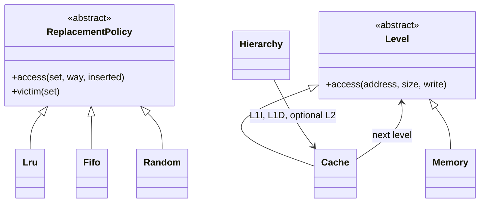
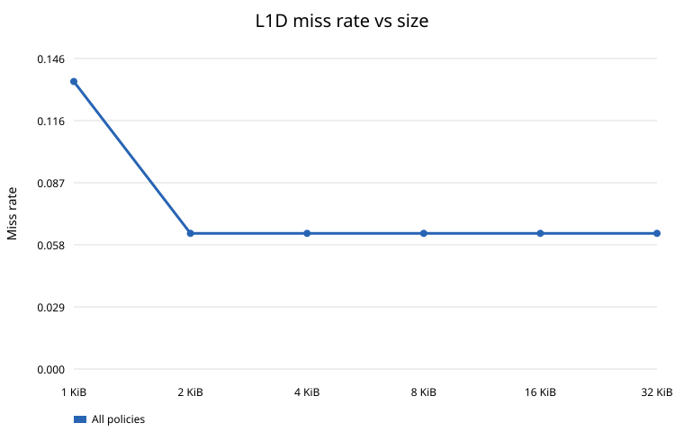
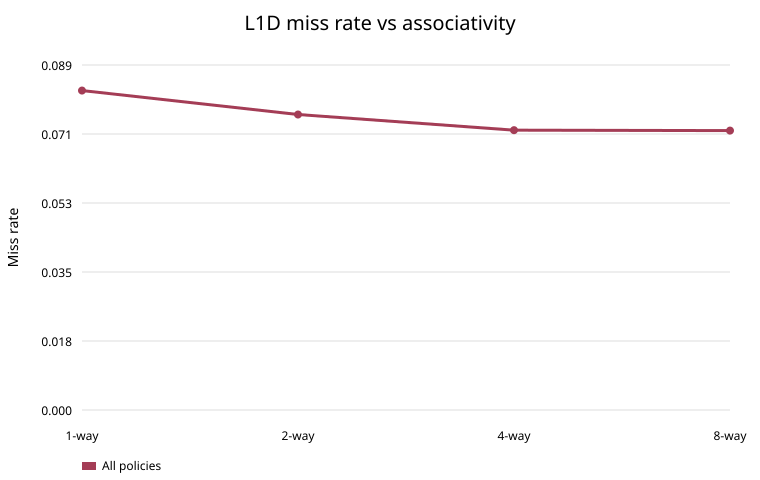
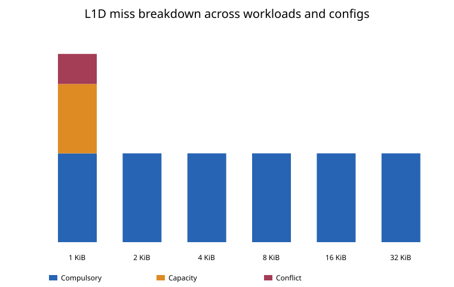
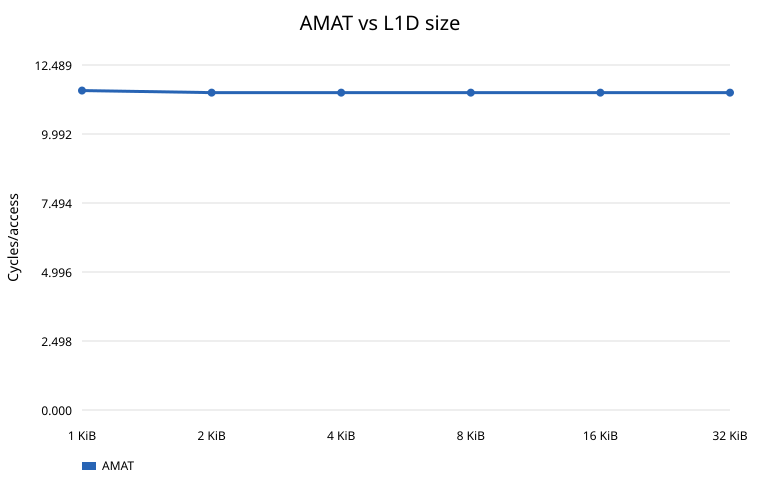
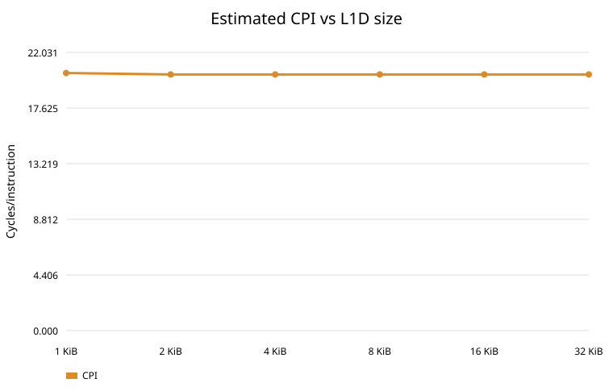

# Cache simulator

This C++17 program reads memory traffic from my RV32IM core and simulates split L1 instruction and data caches, an optional unified L2, and main memory. It counts misses and writebacks and estimates access time and CPI. It does not change the RTL's timing; the timing numbers are estimates from the trace.

## Build and run

```sh
cmake -S . -B build
cmake --build build
ctest --test-dir build --output-on-failure
./build/cachesim --trace traces/matrix_multiply.trace --l1d 8K:4:32 --l1i 8K:2:32 --l2 64K:8:64 --policy lru
```

The `SIZE:WAYS:BLOCK` arguments use bytes unless the size ends in `K` or `M`. `--l2` is optional. `--policy` accepts `lru`, `fifo`, or `random`; `--seed` fixes random replacement. The L1 data write policy is `--write-policy wbwa` (write-back, write-allocate) or `--write-policy wtna` (write-through, no-write-allocate). L2 always uses write-back, write-allocate. The defaults are L1 hit 1 cycle, L2 hit 10 cycles, and memory 100 cycles. `--l1-latency`, `--l2-latency`, and `--memory-latency` change them. Output is JSON.

Run `python3 scripts/generate_traces.py` from this directory to rebuild the 24 Verilator traces from the sibling `outputs/riscv-cpu` project. This runs each program through that project's C retirement model. The trace option is off by default and is compiled only under Verilator. Each line is `I`, `L`, or `S`, followed by a hex address and byte count. An `I` line records an accepted instruction fetch, including fetched instructions later flushed by a branch. The adjacent JSON file records retired instructions and the core's measured base CPI.

To repeat the experiment:

```sh
python3 scripts/sweep.py
python3 scripts/plot.py
```

The sweep writes `results/sweep.csv` and `results/summary.json`. It tests every combination of L1D sizes 1, 2, 4, 8, 16, and 32 KiB; 1, 2, 4, and 8 ways; 16, 32, 64, and 128-byte blocks; and LRU, FIFO, and random replacement. L1I stays at 8 KiB, 2-way, 32-byte blocks. L2 stays at 64 KiB, 8-way, 64-byte blocks. All sweep runs use write-back/write-allocate, seed 1, and 1/10/100-cycle L1/L2/memory latencies.

## Design



Each cache splits an address into block, set, and tag. A miss fills a block from the next level; a dirty eviction writes its block back. The write-through option sends each store to the next level and leaves a store miss unallocated. A fully associative LRU shadow cache of equal capacity classifies demand misses: first reference is compulsory, later shadow misses are capacity, and remaining misses are conflict. For the no-write-allocate option, repeated store misses that would hit the shadow are counted separately as policy misses.

AMAT here is total modeled access cycles divided by trace accesses. Estimated CPI is the core's measured base CPI plus `(modeled access cycles - one cycle per trace access) / retired instructions`. This assumes memory delays serialize and does not model overlap, prefetching, bank conflicts, coherence, or write buffers. The instruction trace includes speculative fetches; those fetches count in the timing estimate.

## Results

The checked-in sweep has 24 traces, 288 configurations per trace, and 6,912 runs. The traces contain 9,525 accesses once, or 2,743,200 accesses across the repeated sweep. Six unit tests pass. The core's Icarus and Verilator suites both pass 24 C-model programs and 49 official ISA binaries, with one Zifencei binary skipped.











The matrix workload places its two input arrays 1 KiB apart. At 1 KiB, 32-byte blocks, and LRU, moving from direct-mapped to 4-way reduced conflict misses from 94 to 0 and total L1D misses from 100 to 6 out of 176 data accesses. The strided array workload has 64 capacity misses at 1 KiB, 32-byte blocks, regardless of associativity. Across the full sweep, raising L1D capacity from 1 to 2 KiB removed all measured capacity and conflict misses. Larger caches did not reduce misses further on these traces. The short branch tests have no data accesses, and their CPI estimates are dominated by instruction fetches; they should not be used to judge the data cache.

The lowest L1D miss rate is 13/769 on `linked_list_walk` with 2 KiB, 1-way, 128-byte blocks, and LRU. The highest is 161/176 on `matrix_multiply` with 1 KiB, 1-way, 64-byte blocks, and LRU. Across all sweep rows, printed AMAT ranges from 1.698106201 to 14.75 cycles/access, and printed estimated CPI ranges from 2.443202495 to 30.0. The high ends come from short branch traces with no data traffic.

## Limits

The traces come from short synthetic and assembly kernels, not a standard benchmark suite. The simulator models tags and traffic, not byte contents or a cycle-accurate pipeline. Dirty lines are counted as writebacks when evicted, not when a trace ends. The 3C breakdown uses a fully associative LRU shadow, so it is a reference classification rather than a proof about every replacement policy. Next I would compile larger C workloads for the core, compare the cache estimates with an RTL cache implementation, and measure timing on hardware.
